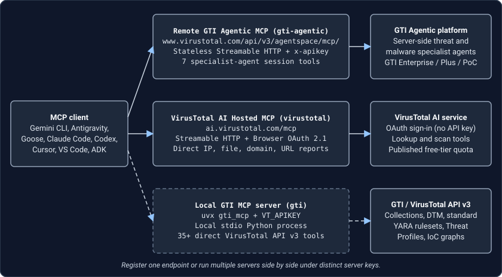

# Remote MCP server for Google Threat Intelligence

The Google Threat Intelligence Agentic MCP server, available in public preview, provides a Google-managed Streamable HTTP endpoint at `https://www.virustotal.com/api/v3/agentspace/mcp/`. Instead of installing a local Python runtime, you connect your MCP client directly to the [Google Threat Intelligence Agentic platform](https://gtidocs.virustotal.com/docs/agentic-platform) with your Google Threat Intelligence API key.

When you call `ask_gti_agent` or `continue_chat`, specialist threat intelligence and malware analysis agents run multi-step pivots across file reports, sandbox behavior traces, threat actors, malware families, campaigns, vulnerabilities, and indicator relationships on the server. Each tool call returns a synthesized Markdown assessment, entity citations, and a stateful `session_id` rather than multi-megabyte VirusTotal API v3 JSON payloads.

## Choose between the remote Agentic server and local `gti-mcp`

Both options authenticate with the same Google Threat Intelligence API key and can run side by side in one MCP client under distinct server names such as `gti-agentic` and `gti`.



| Capability | Remote GTI Agentic MCP server | Local `gti-mcp` server |
| :--- | :--- | :--- |
| Recommended server key | `gti-agentic` | `gti` |
| Transport | Streamable HTTP at `https://www.virustotal.com/api/v3/agentspace/mcp/` | Local `stdio` Python process via `uvx` or `uv` |
| License requirement | Google Threat Intelligence Enterprise or Enterprise Plus | VirusTotal or Google Threat Intelligence API v3 key |
| Authentication | `x-apikey` HTTP request header | `VT_APIKEY` environment variable |
| Tool catalog | 7 stateful investigation and session management tools | Direct VirusTotal API v3 tools across collections, files, hunting rulesets, threat profiles, domains, IPs, and URLs |
| Response format | Synthesized Markdown briefs, entity citations, and `session_id` | Structured API v3 JSON objects and relationships |
| Best fit | Zero-install natural-language threat hunting, multi-turn investigations, and analyst session sharing | Deterministic indicator lookups, custom collection edits, standard YARA file ruleset retrieval, and Threat Profile queries |

For local `gti-mcp` installation and tool reference, see the [Google Threat Intelligence MCP server guide](servers/gti_mcp.md).

## Requirements and data handling

Verify four requirements before connecting an MCP client:

1. **Google Threat Intelligence Enterprise or Enterprise Plus license.** Access to the Agentic platform and its remote MCP endpoint requires an Enterprise or Enterprise Plus entitlement. Standard public VirusTotal API keys return an authorization error on `/api/v3/agentspace/*` routes.
2. **Google Threat Intelligence API key.** Copy your API key from your VirusTotal profile. Follow [How to get GTI API keys](https://gtidocs.virustotal.com/docs/how-get-gti-api-keys) to locate or rotate your key.
3. **Secret storage.** Every request sent with your API key authenticates as your account and draws from your organization's quota. Export the key as an environment variable such as `VT_APIKEY` instead of committing plaintext credentials to repository files.
4. **Prompt hygiene.** Do not include confidential, proprietary, or personally identifiable information in prompts sent to the Agentic platform.

## Endpoint and transport requirements

Configure Streamable HTTP clients with these connection settings:

- **Server URL.** `https://www.virustotal.com/api/v3/agentspace/mcp/`
- **Authentication header.** `x-apikey: <YOUR_GTI_API_KEY>`
- **Transport.** Streamable HTTP using JSON-RPC 2.0 `POST` requests

Pay attention to three protocol behaviors when configuring MCP clients or custom HTTP transports:

- **Keep the trailing slash in the endpoint URL.** Sending a `POST` request to `https://www.virustotal.com/api/v3/agentspace/mcp` without the trailing `/` returns `HTTP 307 Temporary Redirect`. Several MCP HTTP clients drop request bodies or custom authentication headers across redirects.
- **Accept both JSON and event streams.** Requests must send `Accept: application/json, text/event-stream`. Standard MCP SDK transports send both media types automatically, whereas custom HTTP callers that send only `application/json` or only `text/event-stream` fail with `HTTP 406 Not Acceptable`.
- **Raise the client request timeout.** Multi-step investigations with `ask_gti_agent` and `continue_chat` typically run for 45 to 180 seconds while server-side specialist agents pivot across threat intelligence telemetry. Configure a 300-second timeout, or `300000` milliseconds, so complex investigations do not abort at a 30-second or 60-second client default.

## Client configuration

Export your API key in your shell first so clients with environment variable interpolation never write the secret to disk:

```bash
VT_APIKEY="your-gti-api-key"
export VT_APIKEY
```

### Cursor, VS Code, and Cline

Most Streamable HTTP MCP clients read `url` and `headers` under `mcpServers` in `.cursor/mcp.json`, `.vscode/mcp.json`, or `cline_mcp_settings.json`:

```json
{
  "mcpServers": {
    "gti-agentic": {
      "url": "https://www.virustotal.com/api/v3/agentspace/mcp/",
      "headers": {
        "x-apikey": "<YOUR_GTI_API_KEY>"
      }
    }
  }
}
```

### Gemini CLI

In [Gemini CLI](https://geminicli.com), add `gti-agentic` to `~/.gemini/settings.json`. Specify `httpUrl` rather than `url`, because Gemini CLI treats `url` as a legacy Server-Sent Events endpoint and uses `httpUrl` for Streamable HTTP:

```json
{
  "mcpServers": {
    "gti-agentic": {
      "httpUrl": "https://www.virustotal.com/api/v3/agentspace/mcp/",
      "timeout": 300000,
      "headers": {
        "x-apikey": "$VT_APIKEY"
      }
    }
  }
}
```

### Antigravity

Add `gti-agentic` to `~/.gemini/antigravity/mcp_config.json` with `serverUrl`:

```json
{
  "mcpServers": {
    "gti-agentic": {
      "serverUrl": "https://www.virustotal.com/api/v3/agentspace/mcp/",
      "headers": {
        "x-apikey": "<YOUR_GTI_API_KEY>"
      }
    }
  }
}
```

### Claude Code

Register the Streamable HTTP server from your terminal with `claude mcp add`:

```bash
VT_APIKEY="your-gti-api-key"
ENDPOINT_URL="https://www.virustotal.com/api/v3/agentspace/mcp/"

claude mcp add --transport http gti-agentic "$ENDPOINT_URL" \
  --header "x-apikey: $VT_APIKEY"
```

You can also declare `gti-agentic` directly in `~/.claude.json` or a project `.mcp.json` file with `"type": "http"`:

```json
{
  "mcpServers": {
    "gti-agentic": {
      "type": "http",
      "url": "https://www.virustotal.com/api/v3/agentspace/mcp/",
      "headers": {
        "x-apikey": "${VT_APIKEY}"
      }
    }
  }
}
```

### Claude Desktop

For `claude_desktop_config.json` builds that require a `stdio` bridge when passing custom HTTP headers, run `mcp-remote` with `npx`:

```json
{
  "mcpServers": {
    "gti-agentic": {
      "command": "npx",
      "args": [
        "-y",
        "mcp-remote",
        "https://www.virustotal.com/api/v3/agentspace/mcp/",
        "--header",
        "x-apikey:${VT_APIKEY}"
      ],
      "env": {
        "VT_APIKEY": "your-gti-api-key"
      }
    }
  }
}
```

### Goose

In [Goose](https://goose-docs.ai/), from the [aaif-goose/goose](https://github.com/aaif-goose/goose) project, add a `streamable_http` extension to `~/.config/goose/config.yaml`:

```yaml
extensions:
  gti-agentic:
    name: Google Threat Intelligence Agentic MCP
    type: streamable_http
    enabled: true
    uri: https://www.virustotal.com/api/v3/agentspace/mcp/
    timeout: 300
    headers:
      x-apikey: "${VT_APIKEY}"
```

### Verify connectivity with cURL

Test your API key and Enterprise entitlement from a terminal before launching an MCP client:

```bash
VT_APIKEY="your-gti-api-key"
ENDPOINT_URL="https://www.virustotal.com/api/v3/agentspace/mcp/"

curl --silent --show-error -X POST "$ENDPOINT_URL" \
  -H "x-apikey: $VT_APIKEY" \
  -H "Content-Type: application/json" \
  -H "Accept: application/json, text/event-stream" \
  -d '{
    "jsonrpc": "2.0",
    "id": 1,
    "method": "tools/list",
    "params": {}
  }'
```

An entitled Enterprise or Enterprise Plus key returns `HTTP 200` with an `event: message` JSON-RPC response listing all seven tools.

### Google Agent Development Kit in Python

Connect a Python [Google ADK](https://google.github.io/adk-docs/) agent to the remote endpoint with `McpToolset` and `StreamableHTTPConnectionParams`. Omit custom `Accept` overrides from `headers` so the MCP SDK preserves `Accept: application/json, text/event-stream`:

```python
import os
from google.adk.tools.mcp_tool import McpToolset, StreamableHTTPConnectionParams

VT_APIKEY = os.environ["VT_APIKEY"]
GTI_AGENTIC_MCP_URL = "https://www.virustotal.com/api/v3/agentspace/mcp/"

gti_agentic_toolset = McpToolset(
    connection_params=StreamableHTTPConnectionParams(
        url=GTI_AGENTIC_MCP_URL,
        headers={
            "x-apikey": VT_APIKEY,
        },
        timeout=300.0,
        sse_read_timeout=300.0,
    ),
)
```

## Available tools

The remote server exposes seven tools backed by the stateful [Google Threat Intelligence Agentic platform](https://gtidocs.virustotal.com/docs/agentic-platform):

| Tool | Parameters | Description |
| :--- | :--- | :--- |
| `ask_gti_agent` | `message` required | Starts a new natural-language investigation across IoCs, threat actors, malware families, vulnerabilities, and campaigns. Returns the synthesized analysis and a new `session_id`. |
| `continue_chat` | `session_id` required, `message` required | Sends a follow-up question in an existing `session_id` so the agent retains prior findings and citations. |
| `list_sessions` | `limit` optional, default `5` | Lists recent and active investigation sessions owned by the authenticated API key. |
| `get_session_history` | `session_id` required | Retrieves the message and event history recorded for an investigation session. |
| `delete_session` | `session_id` required | Permanently deletes a finished or temporary investigation session. |
| `share_session` | `session_id` required | Generates a `share_token` so another analyst can copy and continue the investigation session. |
| `copy_shared_session` | `share_token` required | Copies a shared session into the caller's workspace under a new `session_id` without modifying the original session. |

## Multi-turn workflow examples

`ask_gti_agent` opens an investigation session and returns a `session_id` such as `a1b2c3d4-e5f6-4321-abcd-ef1234567890`. Your MCP client passes that `session_id` to `continue_chat` on subsequent turns:

1. **IoC reputation and threat actor attribution.**
   - Turn 1 with `ask_gti_agent`: *"What is the current reputation, behavioral summary, and known threat actor attribution for SHA-256 `24d004a104d4d54034dbcffc2a4b19a11f39008a575aa614ea04703480b1022c`?"*
   - Turn 2 with `continue_chat`: *"List network indicators and mutexes observed in those sandbox runs so I can hunt for them in Google SecOps UDM events."*
2. **Recent high-detection sample triage.**
   - Turn 1 with `ask_gti_agent`: *"Triage the highest-detection samples associated with malware family RedLine submitted over the past 7 days."*
   - Turn 2 with `continue_chat`: *"Summarize recurring execution patterns from those samples, separating file and payload traits suited for standard YARA rules from host process telemetry suited for Chronicle YARA-L 2.0 UDM detection rules."*
3. **Threat actor briefings and analyst handoffs.**
   - Turn 1 with `ask_gti_agent`: *"Compile a threat brief on APT44 activity, targeted sectors, and exploited CVEs from the past 90 days."*
   - Handoff with `share_session` and `copy_shared_session`: Generate a `share_token` from the active `session_id` and record it in your incident ticket so a teammate can clone the session into their own workspace and continue investigating independently.

## Troubleshooting

| Symptom | Cause | Resolution |
| :--- | :--- | :--- |
| `HTTP 307 Temporary Redirect` or empty tool list | Trailing slash omitted from the endpoint URL | Set the URL to `https://www.virustotal.com/api/v3/agentspace/mcp/` with the trailing `/`. |
| `HTTP 406 Not Acceptable: Client must accept both application/json and text/event-stream` | Custom `Accept` header specifies only one media type | Send `Accept: application/json, text/event-stream`, or remove custom `Accept` overrides when using an MCP SDK transport. |
| `HTTP 401` or `HTTP 403` authorization error | Missing `x-apikey` header, unexpanded `${VT_APIKEY}` placeholder, or non-Enterprise API key | Confirm `VT_APIKEY` is exported before starting the client and belongs to a Google Threat Intelligence Enterprise or Enterprise Plus license. |
| Gemini CLI `/mcp` reports `Disconnected` | Server entry uses `"url"` instead of `"httpUrl"` | Replace `"url"` with `"httpUrl"` in `~/.gemini/settings.json`. |
| Request times out during `ask_gti_agent` or `continue_chat` | Client enforces a 30-second or 60-second request deadline | Raise the client timeout to `300` seconds, or `300000` milliseconds, and keep each `continue_chat` prompt focused on a single follow-up question. If a call times out after creating a session, call `list_sessions` and `get_session_history` to retrieve the finished response. |

## Related documentation

- [Agentic MCP Server Configuration](https://gtidocs.virustotal.com/docs/agentic-mcp-guide)
- [Google Threat Intelligence Agentic Platform](https://gtidocs.virustotal.com/docs/agentic-platform)
- [How to get GTI API keys](https://gtidocs.virustotal.com/docs/how-get-gti-api-keys)
- [Local Google Threat Intelligence MCP server guide](servers/gti_mcp.md)
