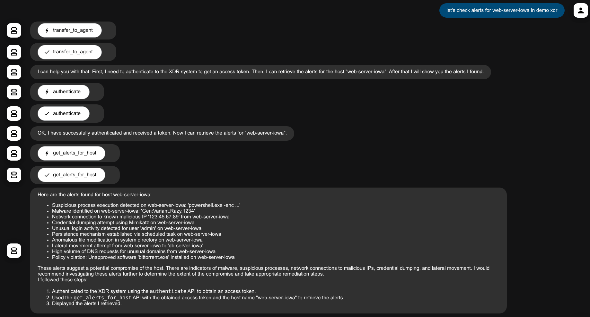
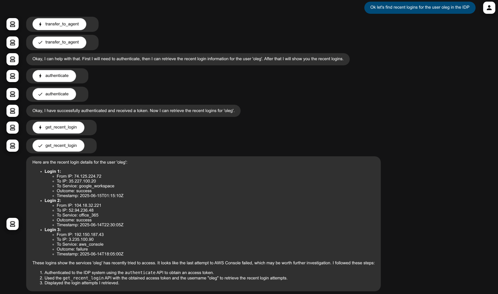

# Google ADK Security Agent Guide

This guide provides instructions on how to run the Autonomous Security Operations Center (SOC) Agent powered by Google ADK v2 and the Model Context Protocol (MCP), both locally via an interactive CLI and deployed to Google Cloud Run.

## Table of Contents

1. [Prerequisites](#prerequisites)
2. [Quickstart: Running Agent Locally](#quickstart-running-agent-locally)
3. [CLI Commands & Options](#cli-commands--options)
4. [Configuration & Environment Variables](#configuration--environment-variables)
5. [Running the Web UI & API Server](#running-the-web-ui--api-server)
6. [Deploying to Google Cloud Run](#deploying-to-google-cloud-run)
7. [Integrating Custom MCP Servers](#integrating-custom-mcp-servers)
8. [Testing & Verification](#testing--verification)

---

## Prerequisites

1. **Python 3.11+**
2. [**uv**](https://docs.astral.sh/uv/) (recommended) or `pip`
3. **Google Cloud Account / Project** with access to one or more of:
   * Google SecOps (Chronicle SIEM)
   * Google Cloud Security Command Center (SCC)
   * Google Threat Intelligence (GTI / VirusTotal)
   * Google SecOps SOAR (Siemplify)
4. **Authentication**:
   * For Google Cloud services (Chronicle, SCC, Vertex AI): Authenticate using Application Default Credentials:
     ```bash
     gcloud auth application-default login
     ```
   * Alternatively, to use the Gemini Developer API without Vertex AI, obtain an API key from [Google AI Studio](https://ai.google.dev/gemini-api/docs/api-key) and configure `GOOGLE_API_KEY`.

---

## Quickstart: Running Agent Locally

### 1. Setup Environment

```bash
cd run-with-google-adk

# Copy the sample environment template
cp .env.example .env
```

Configure your credentials and project IDs in `.env` (see [Configuration](#configuration--environment-variables)).

### 2. Verify Diagnostics

Run `info` to verify package installation, active model, resolved GCP project/ADC credentials, and configured MCP servers:

```bash
uv run mcp-security-agent info
```

### 3. Launch Interactive Chat

Start an interactive threat investigation session with your desired MCP toolsets:

```bash
# Enable Chronicle SIEM MCP tools (alerts, UDM search, rules)
uv run mcp-security-agent chat --secops

# Enable both SecOps SIEM and Security Command Center (SCC)
uv run mcp-security-agent chat --secops --scc
```

You can also provide an initial prompt directly on the command line:

```bash
uv run mcp-security-agent chat --secops "List recent critical security alerts from the past 24 hours"
```

## CLI Commands & Options

The package provides the `mcp-security-agent` CLI entry point.

### `mcp-security-agent info`
Displays current runtime diagnostics:
* Package version
* Active Gemini model & Vertex AI status
* Resolved Google Cloud Project ID and Application Default Credentials (ADC) path
* Toolset status for each supported MCP server

### `mcp-security-agent chat [PROMPT] [OPTIONS]`
Starts an interactive terminal REPL for security investigations.

| Option | Type | Description |
| :--- | :--- | :--- |
| `PROMPT` | Argument | Optional initial prompt to execute immediately upon startup. |
| `--secops / --no-secops` | Flag | Enable or disable Chronicle SIEM MCP (`server/secops`). |
| `--scc / --no-scc` | Flag | Enable or disable Security Command Center MCP (`server/scc`). |
| `--gti / --no-gti` | Flag | Enable or disable Google Threat Intelligence MCP (`server/gti`). |
| `--soar / --no-soar` | Flag | Enable or disable SecOps SOAR MCP (`server/secops-soar`). |
| `--vertex / --no-vertex` | Flag | Toggle Vertex AI (`--vertex`) vs Gemini Developer API (`--no-vertex`). |
| `--model <name>` | String | Override Gemini model name (default: `gemini-2.5-flash`). |
| `--project <id>` | String | Override Google Cloud Project ID. |
| `--customer-id <id>` | String | Override Chronicle Customer ID. |

### `mcp-security-agent serve [OPTIONS]`
Launches the FastAPI application for web UI access or Cloud Run hosting.

| Option | Default | Description |
| :--- | :--- | :--- |
| `--host` | `0.0.0.0` | Network interface to bind to. |
| `--port` | `8080` | Port to listen on (reads `$PORT` environment variable if set). |
| `--reload` | `False` | Enable auto-reload for local development. |
| Tool flags | | Supports the same tool toggles as `chat` (`--secops`, `--scc`, `--gti`, `--soar`, etc.). |

---

## Configuration & Environment Variables

The agent reads configuration from environment variables and an optional `.env` file located in the working directory.

### `.env.example` Template

```properties
# Google Cloud & LLM Settings
GOOGLE_CLOUD_PROJECT=
GOOGLE_CLOUD_LOCATION=us-central1
GOOGLE_GENAI_USE_VERTEXAI=False
GOOGLE_API_KEY=
GOOGLE_MODEL=gemini-2.5-flash

# MCP Server Enablement Flags
# (SCC uses Google Cloud ADC. SecOps, GTI, and SOAR auto-enable when credentials below are populated.
# You can explicitly set LOAD_*_MCP to Y or N to override auto-detection.)
LOAD_SCC_MCP=Y
# LOAD_SECOPS_MCP=
# LOAD_GTI_MCP=
# LOAD_SECOPS_SOAR_MCP=

# Credentials & Service Account Impersonation
SECOPS_SA_PATH=
GOOGLE_APPLICATION_CREDENTIALS=
SECOPS_IMPERSONATE_SERVICE_ACCOUNT=

# Google SecOps (Chronicle SIEM) Settings - Populating enables SecOps MCP
CHRONICLE_PROJECT_ID=
CHRONICLE_CUSTOMER_ID=
CHRONICLE_REGION=us
# Optional: Remote Streamable HTTP MCP endpoint (e.g. https://chronicle.us.rep.googleapis.com/mcp)
# SECOPS_MCP_URL=

# Google Threat Intelligence (GTI / VirusTotal) - Populating enables GTI MCP
VT_APIKEY=
# Optional: Remote GTI Agentic Streamable HTTP MCP endpoint (e.g. https://www.virustotal.com/api/v3/agentspace/mcp/)
# GTI_MCP_URL=

# SecOps SOAR Settings - Populating enables SOAR MCP
SOAR_URL=
SOAR_APP_KEY=

# Runtime Settings
STDIO_PARAM_TIMEOUT=60.0
MINIMAL_LOGGING=N
```

### Environment Variable Reference

| Variable | Default | Description |
| :--- | :--- | :--- |
| `GOOGLE_CLOUD_PROJECT` | None | Google Cloud Project ID for Vertex AI and Cloud Run deployment. |
| `GOOGLE_CLOUD_LOCATION` | `us-central1` | Google Cloud region for Vertex AI endpoints. |
| `GOOGLE_GENAI_USE_VERTEXAI`| `False` | Set `True` to route LLM requests through Vertex AI (uses ADC). Set `False` to use Gemini API (requires `GOOGLE_API_KEY`). |
| `GOOGLE_API_KEY` | None | Gemini API Key (required when `GOOGLE_GENAI_USE_VERTEXAI=False`). |
| `GOOGLE_MODEL` | `gemini-2.5-flash` | Gemini model name (e.g. `gemini-2.5-flash`, `gemini-2.5-pro`). |
| `LOAD_SCC_MCP` | Auto | Enables Security Command Center MCP (`server/scc` or remote `SCC_MCP_URL`). Auto-enables if `SCC_MCP_URL` is set; set `LOAD_SCC_MCP=Y` for the local `stdio` server. Uses ADC. |
| `LOAD_SECOPS_MCP` | Auto | Enables Google SecOps MCP (unified SIEM & SOAR on `SECOPS_MCP_URL`, or local `server/secops`). Auto-enables if `CHRONICLE_PROJECT_ID` and `CHRONICLE_CUSTOMER_ID` are set, or if `SECOPS_MCP_URL` is set. |
| `LOAD_GTI_MCP` | Auto | Enables Google Threat Intelligence MCP. Auto-enables if `VT_APIKEY` or `GTI_MCP_URL` is set. |
| `LOAD_SECOPS_SOAR_MCP` | Auto | Enables standalone local SecOps SOAR MCP (`server/secops-soar`). Auto-enables if `SOAR_URL` and `SOAR_APP_KEY` are set (unified Google SecOps tenants expose remote SOAR tools via `SECOPS_MCP_URL`). |
| `SECOPS_MCP_URL` | None | Remote Google SecOps Streamable HTTP MCP URL (e.g. `https://chronicle.us.rep.googleapis.com/mcp` or regional `https://<region>-chronicle.googleapis.com/mcp`). Uses ADC and replaces the local `stdio` subprocess. |
| `SCC_MCP_URL` | None | Remote Security Command Center Streamable HTTP MCP URL (e.g. `https://securitycenter.googleapis.com/mcp/investigate`). Uses ADC and replaces the local `stdio` subprocess. |
| `GTI_MCP_URL` | None | Remote GTI Agentic Streamable HTTP MCP URL (e.g. `https://www.virustotal.com/api/v3/agentspace/mcp/`). Sends `VT_APIKEY` via `x-apikey` and replaces the local `stdio` subprocess. |
| `CHRONICLE_PROJECT_ID` | None | GCP project ID hosting Chronicle SIEM (also sent as `x-goog-user-project` when `SECOPS_MCP_URL` is set). |
| `CHRONICLE_CUSTOMER_ID` | None | Chronicle Customer ID (UUID). |
| `CHRONICLE_REGION` | `us` | Chronicle regional gateway (`us`, `europe`, `asia`). |
| `VT_APIKEY` | None | VirusTotal / GTI API Key (presence auto-activates GTI tools). |
| `SOAR_URL` | None | Instance URL for SecOps SOAR (presence auto-activates SOAR tools). |
| `SOAR_APP_KEY` | None | API Key for SecOps SOAR. |
| `GOOGLE_APPLICATION_CREDENTIALS` | Auto-detected | Path to service account key file or local `.gcloud/application_default_credentials.json`. |
| `STDIO_PARAM_TIMEOUT` | `60.0` | Timeout in seconds for MCP subprocess initialization and tool execution (remote Streamable HTTP toolsets enforce a 300s SSE read floor and 300s GTI Agentic request floor). |
| `MINIMAL_LOGGING` | `False` | Reduces logging verbosity to suppress sensitive query content in production. |

---

## Running the Web UI & API Server

The built-in FastAPI server provides an interactive web dashboard and REST / Server-Sent Events (SSE) API endpoints.

```bash
uv run mcp-security-agent serve --port 8080
```

Open `http://localhost:8080` in your browser to access the SOC Agent UI.

### REST & Streaming Endpoints

* **`GET /`**: Serves the bundled web landing page and interactive investigation console.
* **`GET /healthz`**: Liveness & readiness probe returning `{"status": "ok"}` for Cloud Run.
* **`GET /info`**: Returns JSON metadata including package version, active model, and toolset configurations.
* **`POST /chat`**: Synchronous chat endpoint accepting `{"prompt": "string", "session_id": "optional"}`.
* **`GET /chat?message=...`**: Server-Sent Events (SSE) token streaming endpoint.

---

## Deploying to Google Cloud Run

The package includes a production-ready [`Dockerfile`](./Dockerfile) configured to run `mcp-security-agent serve` on Cloud Run.

### 1. Build and Deploy

Deploy the service directly from the repository root:

```bash
gcloud run deploy mcp-security-agent-service \
  --source . \
  --region us-central1 \
  --allow-unauthenticated \
  --set-env-vars="LOAD_SECOPS_MCP=Y,LOAD_SCC_MCP=Y,GOOGLE_GENAI_USE_VERTEXAI=True,GOOGLE_CLOUD_PROJECT=YOUR_PROJECT_ID,CHRONICLE_PROJECT_ID=YOUR_PROJECT_ID,CHRONICLE_CUSTOMER_ID=YOUR_CUSTOMER_ID"
```

### 2. IAM Roles

Ensure the runtime Service Account used by Cloud Run has the appropriate IAM permissions:
* **Chronicle API Viewer** (`roles/chronicle.viewer`) on the project hosting Chronicle.
* **MCP Tool User** (`roles/mcp.toolUser`) and **Service Usage Consumer** (`roles/serviceusage.serviceUsageConsumer`) on the quota project when connecting to `SECOPS_MCP_URL` (`chronicle.googleapis.com/mcp` enabled via `gcloud beta services mcp enable chronicle.googleapis.com/mcp`).
* **Security Center Finding Viewer** (`roles/securitycenter.findingsViewer`) for SCC findings.
* **Vertex AI User** (`roles/aiplatform.user`) for Vertex AI model execution.

When deploying with `GTI_MCP_URL`, mount `VT_APIKEY` from Secret Manager (`--set-secrets="VT_APIKEY=vt-apikey:latest"`) rather than baking `.env` credentials into container images.

### 3. Restricting Access in Production

To protect the service in production:
1. In Cloud Run, select `mcp-security-agent-service` and navigate to **Security**.
2. Select **Require authentication**.
3. Under **Permissions**, grant `Cloud Run Invoker` (`roles/run.invoker`) to authorized users.
4. Authorized users can securely access the service locally via proxy:
   ```bash
   gcloud run services proxy mcp-security-agent-service --project YOUR_PROJECT_ID --region us-central1
   ```
   The service will then be reachable at `http://localhost:8080`.

### 4. Memory Limits & Logging Verbosity

* If MCP toolsets process large result sets, consider increasing container memory in Cloud Run Settings to 1 GiB or 2 GiB.
* In production, set `MINIMAL_LOGGING=Y` to suppress full LLM prompt/response logging and reduce Cloud Logging costs.

## Integrating Custom MCP Servers

You can integrate custom security products (such as internal IdPs, custom EDRs, or ticketing systems) using modular sub-agents.

Reference implementations are provided in [`sample_servers_to_integrate/`](./sample_servers_to_integrate/):
* **Sample MCP Servers**: [`sample_servers_to_integrate/mcp_servers/`](./sample_servers_to_integrate/mcp_servers/) (`demo_idp` and `demo_xdr`).
* **Sample Sub-Agents**: [`sample_servers_to_integrate/agents/`](./sample_servers_to_integrate/agents/) (`demo_idp_agent.py` and `demo_xdr_agent.py`).

To attach them to the primary agent in [`src/mcp_security_agent/agent.py`](./src/mcp_security_agent/agent.py):

```python
from sample_servers_to_integrate.agents.demo_idp_agent import create_demo_idp_agent
from sample_servers_to_integrate.agents.demo_xdr_agent import create_demo_xdr_agent

idp_agent = create_demo_idp_agent()
xdr_agent = create_demo_xdr_agent()

agent = LlmAgent(
    name="SecurityOperationsAgent",
    model=settings.google_model,
    instruction=settings.default_prompt or SOC_AGENT_SYSTEM_PROMPT,
    tools=toolsets,
    sub_agents=[sub for sub in [idp_agent, xdr_agent] if sub is not None],
    before_model_callback=bmc_trim_llm_request,
)
```

Configure credentials in `.env`:
```properties
LOAD_XDR_MCP=Y
XDR_CLIENT_ID=demo_client_id
XDR_CLIENT_SECRET=demo_client_secret

LOAD_IDP_MCP=Y
IDP_CLIENT_ID=demo_client_id
IDP_CLIENT_SECRET=demo_client_secret
```

Sample reference interfaces:

**Sample XDR Integration:**


**Sample IDP Integration:**


### Connecting Remote Streamable HTTP MCP Servers (Google SecOps & GTI Agentic)

Instead of spawning local `stdio` MCP subprocesses, you can connect the ADK agent directly to Google-managed remote Streamable HTTP MCP endpoints:

- **Google SecOps Remote MCP (`chronicle.us.rep.googleapis.com/mcp` or regional `<region>-chronicle.googleapis.com/mcp`):** Uses Google Cloud Application Default Credentials (ADC) and an `x-goog-user-project` quota header; see [`docs/remote_server.md`](../docs/remote_server.md).
- **Google Threat Intelligence Agentic MCP (`www.virustotal.com/api/v3/agentspace/mcp/`):** Uses stateless Streamable HTTP with an `x-apikey` header (keep the trailing `/` and omit custom `Accept` header overrides so the MCP SDK sends `Accept: application/json, text/event-stream`); see [`docs/gti_remote_server.md`](../docs/gti_remote_server.md).

#### 1. Declarative `.env` Configuration (Recommended)

Set `GTI_MCP_URL` (with `VT_APIKEY`) or `SECOPS_MCP_URL` (with `CHRONICLE_PROJECT_ID`, using `https://chronicle.us.rep.googleapis.com/mcp` for US tenants or regional `https://<region>-chronicle.googleapis.com/mcp` endpoints for non-US tenants) in `.env`. `build_mcp_toolsets(settings)` in [`src/mcp_security_agent/toolsets.py`](./src/mcp_security_agent/toolsets.py) automatically wires those servers over `StreamableHTTPConnectionParams` instead of spawning local `stdio` subprocesses:

```properties
# Remote Google Threat Intelligence Agentic MCP (replaces local gti-mcp stdio subprocess)
GTI_MCP_URL=https://www.virustotal.com/api/v3/agentspace/mcp/
VT_APIKEY=your_gti_api_key

# Remote Google SecOps MCP (replaces local secops-mcp stdio subprocess;
# for non-US tenants, use https://<region>-chronicle.googleapis.com/mcp)
SECOPS_MCP_URL=https://chronicle.us.rep.googleapis.com/mcp
CHRONICLE_PROJECT_ID=your-chronicle-gcp-project-id
CHRONICLE_CUSTOMER_ID=a1b2c3d4-e5f6-4321-abcd-ef1234567890
CHRONICLE_REGION=us

# Suppress verbose payload logging in production
MINIMAL_LOGGING=Y
```

When `GTI_MCP_URL` is configured, `build_mcp_toolsets(settings)` normalizes the trailing `/` on `/api/v3/agentspace/mcp/`, attaches `x-apikey` on `/api/v3/agentspace/mcp/` (and accepts `vtai_...` Agent Tokens via `x-apikey` when targeting `https://ai.virustotal.com/mcp`), disables HTTP redirects so static API keys cannot follow cross-origin or `http://` redirects, and enforces a minimum 300-second timeout for multi-step server-side investigations. When `SECOPS_MCP_URL` (or `SCC_MCP_URL`) is configured, `build_mcp_toolsets(settings)` validates that the endpoint is a Google-managed `https://*.googleapis.com` origin and injects an origin-pinned `httpx.Auth` client factory wrapping `create_mcp_http_client` so Google Cloud ADC credentials (`SECOPS_SA_PATH` or default ADC, with optional `SECOPS_IMPERSONATE_SERVICE_ACCOUNT`) and `x-goog-user-project` attach on every tool-discovery (`adk web`, `adk graph`, `get_tools()`) and tool-execution request and refresh expired OAuth bearer tokens on a single pooled MCP session.

#### 2. Programmatic `McpToolset` Construction

For custom ADK agents, or when running remote `gti-agentic` side by side with the local `stdio` `gti-mcp` server in [`src/mcp_security_agent/agent.py`](./src/mcp_security_agent/agent.py), construct `McpToolset` with `StreamableHTTPConnectionParams` directly:

- Read `api_key = settings.vt_apikey or os.environ["VT_APIKEY"]` so keys configured in `.env` do not raise `KeyError`.
- Pass `tool_name_prefix="gti_agentic_"` when keeping both remote `gti-agentic` and local `stdio` `gti-mcp` enabled side by side (leave `GTI_MCP_URL` unset in `.env` so `build_mcp_toolsets(settings)` loads local `stdio` `gti-mcp` rather than registering the remote endpoint twice), or set `LOAD_GTI_MCP=N` if replacing the built-in local `stdio` toolset manually.
- Set `MINIMAL_LOGGING=Y` in production (`bootstrap_environment()` clamps `google_adk`, `google.adk`, `httpx`, and `httpcore` loggers to `WARNING`, unsets `ADK_EXPERIMENTAL_TELEMETRY`, sets `ADK_CAPTURE_MESSAGE_CONTENT_IN_SPANS=false`, and omits `function_call.args` dumps in SSE `tool_call` events). Avoid re-enabling `google_adk` `DEBUG` logging while `MINIMAL_LOGGING=N`, because ADK's built-in `_redact_headers` masks `x-api-key` rather than `x-apikey`.

```python
import os
from google.adk.agents.llm_agent import LlmAgent
from google.adk.tools.mcp_tool import McpToolset, StreamableHTTPConnectionParams
from mcp_security_agent.agent import SOC_AGENT_SYSTEM_PROMPT
from mcp_security_agent.callbacks import bmc_trim_llm_request
from mcp_security_agent.config import AgentSettings
from mcp_security_agent.toolsets import build_mcp_toolsets

settings = AgentSettings()
GTI_AGENTIC_MCP_URL = "https://www.virustotal.com/api/v3/agentspace/mcp/"
api_key = settings.vt_apikey or os.environ["VT_APIKEY"]

gti_agentic_toolset = McpToolset(
    connection_params=StreamableHTTPConnectionParams(
        url=GTI_AGENTIC_MCP_URL,
        headers={
            "x-apikey": api_key,
        },
        timeout=300.0,
        sse_read_timeout=300.0,
    ),
    tool_name_prefix="gti_agentic_",
)

toolsets = build_mcp_toolsets(settings)
toolsets.append(gti_agentic_toolset)

agent = LlmAgent(
    name="SecurityOperationsAgent",
    model=settings.google_model,
    instruction=settings.default_prompt or SOC_AGENT_SYSTEM_PROMPT,
    tools=toolsets,
    before_model_callback=bmc_trim_llm_request,
)
```

---

## Testing & Verification

Run the hermetic test suite:

```bash
uv run --extra test pytest tests/
```

All 54 unit and loopback HTTP tests run hermetically using local loopback MCP endpoints, mocked MCP connection parameters, and simulated LLM responses.


